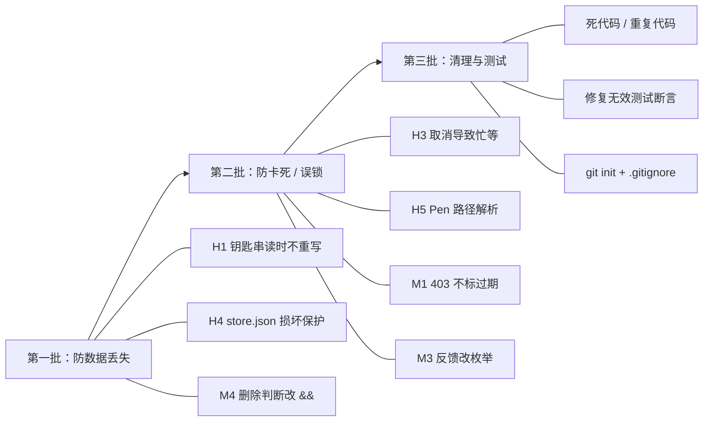

# Pencil Account Switcher 代码审阅报告

- **审阅范围**：`Sources/Switchboard/**`（共 11 个 Swift 文件，约 3,000 行）、`Tests/`、`build.sh`、`Support/Info.plist`
- **审阅方式**：逐文件通读 + 符号引用检索 + `swiftc -typecheck`（只有 1 条警告：`SecAccessCreate` 已废弃）
- **严重度**：🔴 高（会导致数据丢失、卡死或功能出错） · 🟠 中（特定条件下出错，或有安全/健壮性隐患） · 🟡 低（冗余、可维护性、体验）

---

## 一、总览

| 等级 | 数量 | 主要集中在 |
|---|---|---|
| 🔴 高 | 5 | 钥匙串读写、切换流程的取消处理、持久化加载、Pen 路径写死 |
| 🟠 中 | 11 | 额度 403 处理、设备 ID、反馈状态判断、热键、并发 |
| 🟡 低 | 20+ | 死代码、重复代码、硬编码、测试失效 |

整体上架构比较清楚：Adapter / QuotaProvider / CredentialStore / WebLoginProvider 都抽成了协议，切换流程考虑了回滚，刷新时跨 `await` 也会按 id 重新查找账号，这些都值得保留。问题主要在**钥匙串层**、**取消与超时路径**，以及**“状态靠字符串判断”**这类隐式约定上。

---

## 二、🔴 高优先级问题

### H1. 钥匙串“迁移”逻辑每次读取都会删除再重写凭据，删除后写入失败就会丢凭据

[KeychainStore.swift#L40-L53](file:///Users/apple/Documents/pen_switch_account/Sources/Switchboard/KeychainStore.swift#L40-L53)、[#L97-L110](file:///Users/apple/Documents/pen_switch_account/Sources/Switchboard/KeychainStore.swift#L97-L110)

- macOS 上的 Data Protection Keychain（`kSecUseDataProtectionKeychain`）需要 `keychain-access-groups` / `application-identifier` 授权（entitlement）。`build.sh` 用的是 ad-hoc 签名且不带 entitlements，所以 **modern 分支的写入基本一定失败**（`errSecMissingEntitlement`，-34018）。
- 结果是每次 `load()`：modern 读失败 → legacy 读成功 → 尝试“迁移”：modern 写失败 → `writeOrThrow(..., dataProtection: false)` → **先 `SecItemDelete` 再 `SecItemAdd` 同一条 legacy 凭据**。
- 刷新额度、切换账号都会调用 `load`，等于**每读一次就删一次、重写一次**。只要 `SecItemAdd` 失败一次（例如用户拒绝授权、钥匙串被锁），这条凭据就从钥匙串里永久消失了（只剩本次内存里的副本）。
- `writeOrThrow` 本身就是“先删后加”，不是原子操作，`save()` 也有同样的风险窗口。

**建议**
1. `load()` 读到 legacy 条目时，只有 modern 写入**成功**才删除 legacy；modern 不可用就直接返回数据，不做任何写入。
2. 写入改为 `SecItemUpdate`，返回 `errSecItemNotFound` 时再 `SecItemAdd`，避免“删除后写入失败”的窗口。
3. 启动时探测一次 data protection 是否可用并缓存结果，避免每次调用都走一遍失败路径。

### H2. `SecAccessCreate(trustedlist: nil)` 的注释与实际语义不符

[KeychainStore.swift#L116-L123](file:///Users/apple/Documents/pen_switch_account/Sources/Switchboard/KeychainStore.swift#L116-L123)

- 注释写的是“trustedList 传 nil：任意应用可访问”。但按 Apple 文档，`trustedlist` 传 `NULL` 表示**只信任调用方应用**（传空数组才表示不信任任何应用）。所以这段代码并不能解决“重签后 cdhash 变化导致弹窗”的问题。
- 反过来，如果真的做到了“任意应用免授权读取”，那就意味着**本机任何进程都能静默读出所有账号的 sessionToken**，这是明显的安全降级。
- 该 API 自 10.10 起已废弃（也是本项目唯一的编译警告）。

**建议**：放弃“任意应用可访问”这个思路。改用固定的签名身份（开发者证书或自签证书），让 designated requirement 保持稳定；如果坚持 ad-hoc，就接受重编译后弹一次授权框，并修正注释。

### H3. 添加账号时点“取消”或碰上超时，切换阶段会让主线程忙等最多 15 秒（UI 卡死）

[AppModel.swift#L126-L166](file:///Users/apple/Documents/pen_switch_account/Sources/Switchboard/AppModel.swift#L126-L166)、[PenTargetAdapter.swift#L107-L117](file:///Users/apple/Documents/pen_switch_account/Sources/Switchboard/PenTargetAdapter.swift#L107-L117)

- 网页登录成功后，`loginTask` 会继续执行 `await switchTo(record, activateNewLogin: true)`，而此时 `addingAccount` 仍为 `true`，所以按钮仍显示「取消网页登录」。
- 如果这时用户点了取消，或者 300 秒的超时 Task 恰好触发，`loginTask` 就会被 cancel。`terminateAndWait` 里的 `try? await Task.sleep(...)` 在已取消的 Task 中会**立即抛错**，又被 `try?` 吞掉，`while` 循环于是变成**在 MainActor 上空转**，直到 15 秒截止。整个应用 UI 在这段时间都没有响应。
- 同时切换流程也不会因为取消而停下，“取消”在这一阶段实际上没有效果。

**建议**
- `terminateAndWait` 改用 `try await Task.sleep`，并在取消时返回 `false`；或者用 `Task.isCancelled` 跳出循环。
- 进入切换阶段后把 UI 状态改成“切换中”（例如先把 `addingAccount` 置为 `false` 再设 `switchingTo`），不再允许取消；或者明确规定切换阶段不响应取消。
- 更彻底的做法：监听 `NSWorkspace.didTerminateApplicationNotification`，或对 `NSRunningApplication.isTerminated` 做 KVO，替代轮询。

### H4. `store.json` 解析失败时静默忽略，之后会用空数据覆盖原文件

[AppModel.swift#L84-L101](file:///Users/apple/Documents/pen_switch_account/Sources/Switchboard/AppModel.swift#L84-L101)

- `load()` 用 `try?` 解码，失败（文件损坏、未来版本新增了非可选字段、`AuthState` 出现新枚举值等）就直接 `return`。
- 紧接着 `didSyncPersistence = true`，然后 `settings.launchAtLogin = ...` 触发 `persist()`，**立刻用空账号列表覆盖原文件**。账号元数据全部丢失，钥匙串里的凭据变成孤儿条目，无法再关联。
- `storeVersion` 字段写入了，但从来没读过，也没有迁移逻辑。

**建议**：解码失败时先把原文件备份为 `store.json.corrupt-<时间戳>`，并给出提示；或者在这种情况下禁止落盘。读取时校验 `storeVersion`；`AuthState` 用自定义 `init(from:)` 兜底到 `.unknown`。

### H5. Pen 的路径写死为 `/Applications/Pen.app`

[PenTargetAdapter.swift#L52](file:///Users/apple/Documents/pen_switch_account/Sources/Switchboard/PenTargetAdapter.swift#L52)、[#L119-L122](file:///Users/apple/Documents/pen_switch_account/Sources/Switchboard/PenTargetAdapter.swift#L119-L122)

如果用户把 Pen 装在 `~/Applications`、改了名，或者通过 Setapp 之类的渠道安装，`launch()` 就会抛错。在切换流程里，这意味着 **Pen 已经被退出、会话文件也已改写，但 Pen 拉不起来**，用户看到的提示是“切换失败”，而 Pen 处于关闭状态。

**建议**：`NSWorkspace.shared.urlForApplication(withBundleIdentifier: "dev.pencil.desktop")` 优先，找不到再退回固定路径；也可以在退出 Pen 之前就先解析出路径，没找到就直接中止切换。

---

## 三、🟠 中优先级问题

### M1. 额度接口返回 403 就标记“登录已过期”，账号会被锁死、无法切换
[QuotaProvider.swift#L62-L64](file:///Users/apple/Documents/pen_switch_account/Sources/Switchboard/QuotaProvider.swift#L62-L64)、[AppModel.swift#L211](file:///Users/apple/Documents/pen_switch_account/Sources/Switchboard/AppModel.swift#L211)

403 通常表示“没有权限”，例如套餐不含该 feature，不一定是会话过期。但一旦被标成 `.expired`，`switchTo` 和 UI 都会**禁止切换到这个账号**，只能重新网页登录才能恢复。另外，额度接口是判断“过期”的唯一依据，这个判断本身就偏重。
**建议**：只把 401 映射为 `.expired`，403 当作 `.failure`；`.expired` 只作为提示，不要拦住切换（切换后的身份校验本身就能兜底）。

### M2. 设备 ID 的计算可能和 Pen 不一致，而且可能阻塞主线程
[QuotaProvider.swift#L83-L92](file:///Users/apple/Documents/pen_switch_account/Sources/Switchboard/QuotaProvider.swift#L83-L92)

- 注释说要与 Node 的 `os.hostname()` 保持一致，而 Node 底层用的是 `gethostname()`。`ProcessInfo.hostName` 走的是网络名解析，可能返回 FQDN、反向 DNS 名或 `localhost`，与前者不一定相同，算出的 `X-Device-Id` 就会和 Pen 本体对不上。
- `ProcessInfo.hostName` 在某些网络环境下会**同步阻塞数秒**。`PenWebLogin.signIn` 运行在 `@MainActor` 上，会直接卡住 UI（[WebLogin.swift#L107](file:///Users/apple/Documents/pen_switch_account/Sources/Switchboard/WebLogin.swift#L107)）。

**建议**：改用 `gethostname()`，并把结果缓存为 `static let`。

### M3. “账号已保存；切换失败…”会被显示成成功样式
[Screens.swift#L240-L247](file:///Users/apple/Documents/pen_switch_account/Sources/Switchboard/UI/Screens.swift#L240-L247)、[AppModel.swift#L158](file:///Users/apple/Documents/pen_switch_account/Sources/Switchboard/AppModel.swift#L158)

`isSuccessStatus` 用 `hasPrefix("账号已保存")` 判断成功，而失败分支拼出来的文案正好以“账号已保存”开头，于是失败信息用了对勾图标和成功配色。
另外，第 158 行拼接的是 `feedback` 的当前值：如果 `switchTo` 因为 guard 提前返回、没有设置任何反馈，拼进去的可能是还没过期的旧文案「请在网页登录要添加的账号」。
**建议**：用 `enum FeedbackKind { success, loading, warning }` 或结构体随反馈一起传递，不要靠匹配中文字符串判断状态。现有的 `feedbackIsQuota` 正好可以改造成这个用途（它目前根本没被读取，见 L 节）。`switchTo` 改为返回 `Result<Void, Error>`，调用方根据错误自行拼接文案。

### M4. 钥匙串的删除判断用 `||`，可能残留孤儿凭据
[KeychainStore.swift#L55-L62](file:///Users/apple/Documents/pen_switch_account/Sources/Switchboard/KeychainStore.swift#L55-L62)

只要 modern 返回成功或 NotFound，即使 legacy 删除失败也视为成功。账号会从列表中移除，但 token 还留在钥匙串里。正确的条件应该是**两者都**为成功或 NotFound（`&&`），并忽略 `errSecMissingEntitlement`。

### M5. 读取凭据失败一律报“凭据缺失”
[KeychainStore.swift#L80-L91](file:///Users/apple/Documents/pen_switch_account/Sources/Switchboard/KeychainStore.swift#L80-L91)、[AppModel.swift#L324-L326](file:///Users/apple/Documents/pen_switch_account/Sources/Switchboard/AppModel.swift#L324-L326)

`read` 把所有非成功状态（用户拒绝授权、钥匙串被锁、解码失败）都变成 `nil`，最后统一显示“凭据缺失，请重新导入”，会误导用户去重新登录。另外，`LAContext.interactionNotAllowed` 主要对 data protection keychain 生效，对 legacy 文件钥匙串**未必能阻止弹窗**。
**建议**：把 `OSStatus` 透传出来，按错误类型分别给出提示。

### M6. 切换后的身份校验是在 Pen 刚启动时做的，不够可靠
[AppModel.swift#L259-L271](file:///Users/apple/Documents/pen_switch_account/Sources/Switchboard/AppModel.swift#L259-L271)

`openApplication` 返回时 Pen 才刚启动，还没校验 token。此时读到的会话文件必然是刚写进去的那份，所以校验几乎一定通过。如果 Pen 随后因为 token 失效清空了会话，切号器并不知道。另外，第 263–267 行先手动设置 `isCurrent`，第 268 行的 `syncCurrentIdentity()` 又会按 `liveEmail` 重新计算一遍，还把 `authState = .ok` 写在了校验**之前**。
**建议**：校验放到 `applySnapshot` 之后、`launch` 之前（`applySnapshot` 内部已经做了）；启动后可以延迟几秒再做一次软校验，只提示不回滚。删掉重复的手动标记代码。

### M7. 刷新额度与切换/添加可以并发进行
`refreshAllQuotas` 不检查 `switchingTo` / `addingAccount`，`switchTo` 也不检查 `refreshing`。刷新过程中会多次调用 `syncCurrentIdentity()`，在切换途中把 `isCurrent` 标记来回改，UI 会闪烁。目前因为按 email 匹配回存凭据，还没有造成数据错乱，但这是一个隐患。
**建议**：把这三个操作统一成一个“操作锁”（例如 `enum BusyState`），刷新期间也禁用切换按钮。

### M8. 全局热键 ⌘⇧A 冲突面大，注册失败也没有提示
[HotKeyCenter.swift#L28-L31](file:///Users/apple/Documents/pen_switch_account/Sources/Switchboard/HotKeyCenter.swift#L28-L31)

- ⌘⇧A 是 Finder「前往应用程序」、Chrome「搜索标签页」等常用快捷键，`RegisterEventHotKey` 会在**全系统范围**抢占它。
- `InstallEventHandler` / `RegisterEventHotKey` 的返回值都被忽略；如果组合键已被占用，注册失败也不会提示，界面上却仍然显示“⌘ ⇧ A”。
- 回调没有校验 `EventHotKeyID`，以后再注册第二个热键就会串。

### M9. `HotKeyCenter` 自己持有自己，`deinit` 永远不会执行
[HotKeyCenter.swift#L17](file:///Users/apple/Documents/pen_switch_account/Sources/Switchboard/HotKeyCenter.swift#L17)、[#L34-L38](file:///Users/apple/Documents/pen_switch_account/Sources/Switchboard/HotKeyCenter.swift#L34-L38)

`passRetained(self)` 形成了自引用，`deinit` 里的注销代码是死代码。对象和应用同生命周期，所以目前没有实际危害，但会误导读代码的人。重复调用 `register` 还会泄漏引用并重复注册。改用 `passUnretained`，并提供显式的 `unregister()`。

### M10. 网页登录的若干细节
[WebLogin.swift](file:///Users/apple/Documents/pen_switch_account/Sources/Switchboard/WebLogin.swift)
- [L22](file:///Users/apple/Documents/pen_switch_account/Sources/Switchboard/WebLogin.swift#L22) `window!` 强制解包了一个 `weak` 属性，窗口释放后会直接崩溃。建议兜底返回 `ASPresentationAnchor()`。
- [L76](file:///Users/apple/Documents/pen_switch_account/Sources/Switchboard/WebLogin.swift#L76) PKCE verifier 由 UUID 拼接而成，熵够用，但更规范的做法是用 `SecRandomCopyBytes` 生成 32 字节再做 base64url。
- [L141](file:///Users/apple/Documents/pen_switch_account/Sources/Switchboard/WebLogin.swift#L141) 生成的会话文件只有 `{email, token}`。如果 Pen 将来在 `session-desktop.json` 里加了字段（例如 refresh token、过期时间），通过网页登录添加的账号会缺少这些字段，而“导入当前登录”保存的则是原始文件，两种来源的快照就不一致了。
- 网页登录期间面板可能因为点击外部而被收起（认证窗口不一定以 sheet 形式挂在面板上，`attachedSheet` 判断不一定能覆盖到）。

### M11. 邮箱比较区分大小写
多处用 `==` 比较 email（去重、`isCurrent` 判定、校验）。`Foo@x.com` 和 `foo@x.com` 会被当成两个账号，也可能出现“未登记身份”的误报。建议统一 `lowercased()` 后再比较，或者保存一个规范化后的 key。

---

## 四、🟡 低优先级：冗余 / 死代码

| 位置 | 问题 |
|---|---|
| [AppModel.swift#L283](file:///Users/apple/Documents/pen_switch_account/Sources/Switchboard/AppModel.swift#L283) `canRemoveAnyAccount` | 从未使用。而且它的语义（count > 1）与 `remove()` 实际的规则（不能移除当前账号）不一致 |
| [AppModel.swift#L32](file:///Users/apple/Documents/pen_switch_account/Sources/Switchboard/AppModel.swift#L32) `feedbackIsQuota` | 只写不读 |
| [Models.swift#L28](file:///Users/apple/Documents/pen_switch_account/Sources/Switchboard/Models.swift#L28) `addedAt`、[#L46](file:///Users/apple/Documents/pen_switch_account/Sources/Switchboard/Models.swift#L46) `storeVersion` | 只写不读 |
| [Models.swift#L40-L42](file:///Users/apple/Documents/pen_switch_account/Sources/Switchboard/Models.swift#L40-L42) `AppSettings.launchAtLogin` | 每次启动都会被 `SMAppService.status` 覆盖，持久化它没有意义；默认值 `true` 也会误导。建议改成计算属性 |
| [QuotaProvider.swift#L30-L34](file:///Users/apple/Documents/pen_switch_account/Sources/Switchboard/QuotaProvider.swift#L30-L34) `allowed` / `remaining` | 解码了但没用。`plan` 恒为 `nil`，所以界面上的方案名永远为空（README 已说明，属于待接入项） |
| [AppMain.swift#L17-L19](file:///Users/apple/Documents/pen_switch_account/Sources/Switchboard/AppMain.swift#L17-L19) | 演示模式的环境变量在 AppDelegate 和 AppModel 中各判断了一次；而演示模式下 `refreshAllQuotas` 会直接 return，传进去的 `UnsupportedQuotaProvider` 根本用不上 |
| [AppMain.swift#L38-L43](file:///Users/apple/Documents/pen_switch_account/Sources/Switchboard/AppMain.swift#L38-L43) | `didResize` 观察者只用来打调试日志 |
| [AppMain.swift#L82-L83](file:///Users/apple/Documents/pen_switch_account/Sources/Switchboard/AppMain.swift#L82-L83) | 嵌套两层 `asyncAfter`（0.3s + 0.5s），合并成一次 0.8s 即可 |
| [AppKitCommon.swift](file:///Users/apple/Documents/pen_switch_account/Sources/Switchboard/UI/AppKitCommon.swift) | `DotView`、`Theme.accent(for:)`、`statusDot`、`inUseDot`、`onAccent` 未使用；`Theme` 里有大量值相同的别名（`titleText`/`rowTitle`/`accent`/`accentInk`/`switchBtnBG`、`textSecondary`/`descText`/`planText`/`textTertiary`…）。如果是为了对齐设计 token 可以保留，但建议注明 |
| [AppKitCommon.swift#L3-L6](file:///Users/apple/Documents/pen_switch_account/Sources/Switchboard/UI/AppKitCommon.swift#L3-L6) | Hallmark 工具生成的元信息注释，和代码无关 |
| [Screens.swift#L50](file:///Users/apple/Documents/pen_switch_account/Sources/Switchboard/UI/Screens.swift#L50) `maxScrollHeight` 参数 | 所有调用方都用默认值，`cachedMaxScrollHeight` 等于常量 |
| [Screens.swift#L34](file:///Users/apple/Documents/pen_switch_account/Sources/Switchboard/UI/Screens.swift#L34) | `loadView` 里设置的 `edgeInsets` 和 `contentInsets` 的默认值重复，`finalize` 还会再覆盖一次 |
| [Screens.swift](file:///Users/apple/Documents/pen_switch_account/Sources/Switchboard/UI/Screens.swift) 三个 `rebuild()` | 开头清空 `contentStack` 的循环重复了 3 次，可以上移到 `BaseScreen`；`makeAddButton` 在 Main/Manage 中各写了一遍 |
| [AppModel.swift#L184-L190](file:///Users/apple/Documents/pen_switch_account/Sources/Switchboard/AppModel.swift#L184-L190) | 手动设置 `isCurrent` 之后紧接着 `syncCurrentIdentity()` 会再算一遍，手动这一步多余 |
| [AppModel.swift#L209-L275](file:///Users/apple/Documents/pen_switch_account/Sources/Switchboard/AppModel.swift#L209-L275) | `syncCurrentIdentity()` 在一次切换中最多被调用 5 次 |
| [PenTargetAdapter.swift#L76-L84](file:///Users/apple/Documents/pen_switch_account/Sources/Switchboard/PenTargetAdapter.swift#L76-L84) | 先读成 `String` 再转回 `Data` 解码，读一次 `Data` 就够了 |
| `SWITCHBOARD_DEBUG` 判断 | 分散在 4 处，每次都读环境变量，应该集中成一个 `Log.debug()` |

> [!NOTE]
> `switchTo` 里的 `if activateNewLogin { try saveSnapshot(snapshot, for: target.id) }`（L244）**看起来多余，其实是必需的**：重新登录已存在的当前账号时，第 1 步“回存当前活跃状态”会用旧 token 覆盖刚保存的新快照，这一行负责把新快照写回去。建议补一行注释，以免以后被误删。

---

## 五、🟡 低优先级：不合理 / 可维护性

1. **持久化写放大**：`accounts` 的 `didSet` 每次都会写整个文件。一次刷新中每个账号会修改 5–6 个字段，就会写 5–6 次；`syncCurrentIdentity` 循环里也是每改一个元素写一次。建议合并写入（例如用 `objectWillChange.debounce`，或者先修改局部副本再一次性赋值）。
2. **`persist()` 失败会调用 `showFeedback`**，会覆盖掉正在显示的切换/刷新结果。
3. **用中文字符串当状态机**：`isLoadingStatus` / `isSuccessStatus` / `text == "额度已刷新"` 等判断，只要改一下文案逻辑就会失效（参见 M3）。
4. **硬编码**：设置页的「版本 1.0.0」（[Screens.swift#L527](file:///Users/apple/Documents/pen_switch_account/Sources/Switchboard/UI/Screens.swift#L527)）应改为读取 `CFBundleShortVersionString`（右键菜单已经是这样读的）；README 写的是 v0.1，Info.plist 是 1.0.0，两者不一致。“⌘ ⇧ A”文案出现在 2 处，应该从热键配置生成。
5. **`FullHitButton` / `InkSwitch` 重写了 `mouseDown`，但不检查 `isEnabled`**：控件被禁用后仍然能触发动作。目前恰好没有禁用它们的场景，属于潜在问题。`InkSwitch` 里的无障碍标签写死成了“开机自动启动”。
6. **`PanelController` 用 `receive(on: RunLoop.main)`**：Combine 的 RunLoop 调度器只在 default mode 下执行，鼠标拖动或菜单追踪期间 UI 不会更新，建议改用 `DispatchQueue.main`。
7. **`footerQuotaText` 每次 rebuild 都新建一个 `DateFormatter`**，且没有固定 locale。
8. **强制解包**：`confirmRemove` 中的 `view.window!`、`captureSnapshots` 中的 `panelWindow!.contentViewController!`、`RefreshButton` 中的 `NSImage(systemSymbolName:)!`。
9. **`RefreshButton` 在 init 时固定了 `NSScreen.main` 的 scale**，多显示器（不同缩放）之间切换时图标可能发虚。
10. **`togglePopover` 命名残留**：NSPopover 早已不用，函数名仍是 `togglePopover`。
11. **回滚路径里 `adapter.launch()` 的异常会覆盖原始错误**（[AppModel.swift#L255](file:///Users/apple/Documents/pen_switch_account/Sources/Switchboard/AppModel.swift#L255)），用户看到的是“启动失败”，而不是真正的切换失败原因。
12. **`terminate()` 遇到 Pen 弹出“未保存”对话框时**，15 秒后切换器报失败；但用户之后确认退出，Pen 还是会关掉，最终状态是“Pen 被关了，账号却没切”。

---

## 六、测试与工程

| 问题 | 说明 |
|---|---|
| 无效断言 | [RegressionTests.swift#L410-L413](file:///Users/apple/Documents/pen_switch_account/Tests/RegressionTests.swift#L410-L413) 查找的 `"operation-feedback"` 标识在源码中已不存在，因此第 274、299、307、313 行的 `feedbackView(...) == nil` **恒为真**，起不到测试作用 |
| 过时的标签 | “overlay mint scroller”（配色已改为石墨色） |
| 覆盖盲区 | `KeychainStore`（H1/M4 最该测）、`PenQuotaProvider` 的响应解析、`store.json` 损坏的处理（H4）、切换阶段的取消（H3）、`FakeTarget.terminateAndWait` 不能模拟“退出超时” |
| `Tests/run.sh --ui` | 只生成了 QA .app，没有启动它 |
| `build.sh` | 没有指定 `-module-cache-path`（在本机 CLT 与 SDK 版本不匹配的环境下，默认缓存路径会报错）；`codesign` 的输出被丢弃，签名失败时看不到原因；中间产物 `build/Switchboard` 没有清理 |
| 仓库卫生 | 项目**不是 git 仓库**；`.DS_Store`、`build/`、`.build/`、`.hallmark/` 都混在源码目录里。建议 `git init` 并添加 `.gitignore` |

---

## 七、修复优先级建议

1. **先修 H1、H4、M4**：这三项都可能让用户的账号数据或凭据静默丢失，而且改动范围小。
2. **再修 H3、H5、M1、M3**：分别影响可用性（卡死、拉不起 Pen）和正确性（账号被误锁、失败显示成成功）。
3. **H2 需要先做决定**：是换成稳定的签名身份，还是接受重编译后弹一次授权框。
4. 其余冗余和可维护性问题可以在下一次重构时一并处理。
