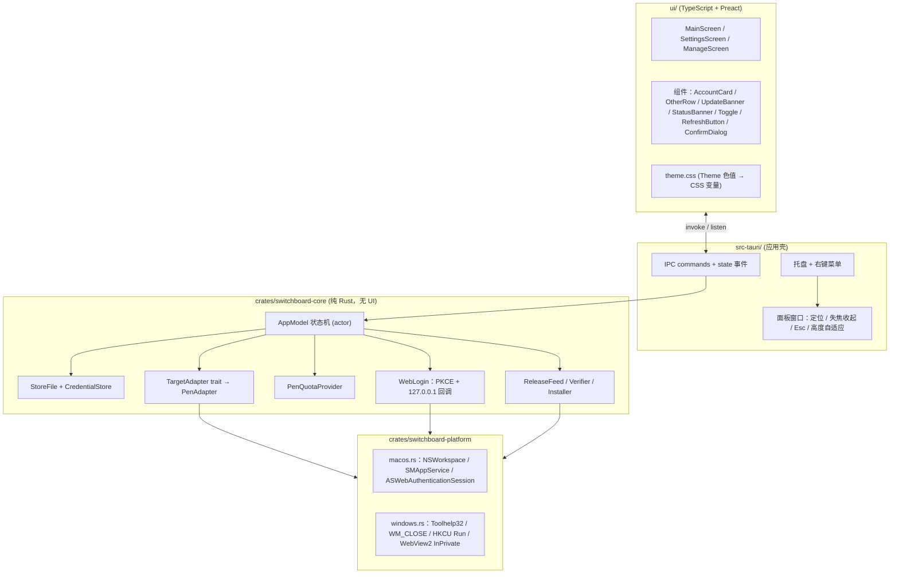

# Pencil Account Switcher 双端重构方案（macOS + Windows）

> 本文是设计说明。具体任务拆分见 [DEV_PLAN.md](DEV_PLAN.md)，测试与验收见 [TEST_PLAN.md](TEST_PLAN.md)。第 10 节的阶段表以 DEV_PLAN 为准。

> 基线：`main` @ `0f2ab7d`，与 `origin/main` 一致，版本 1.0.1。Swift 约 3,600 行（不含测试），零第三方依赖。
> 目标：一套代码同时出 macOS 版和 Windows 版，**交互流程、界面布局、配色、文案都不变**。

---

## 1. 范围

### 1.1 必须保持不变

| 类别 | 内容 |
|---|---|
| 交互 | 左键点托盘或菜单栏图标开关面板；右键弹菜单（打开面板 / 版本号 / 退出）；点面板外或按 Esc 收起；添加账号、切换、更新进行中面板不收起；面板刚打开 0.35 秒内的重复点击忽略 |
| 页面 | 主页、设置、管理三个页面，路由逻辑一样，每次打开面板回到主页 |
| 视觉 | 宽 410pt，圆角 16，`Theme` 里的所有色值，头像配色哈希（`stableHash`），面板高度随内容变化（200 到 900） |
| 文案 | 所有中文提示和错误文案，以及反馈条自动消失时长 `min(20, max(6, 字数/10+4))` 秒 |
| 切号流程 | 回存当前会话 → 退出 Pen → 落盘 → 校验 → 失败回滚 → 重新拉起 → 4 秒后再校验一次（只提示），步骤和顺序都和 `AppModel.switchTo` 一致 |
| 数据（macOS） | `~/Library/Application Support/Switchboard/store.json` 和 `credentials/<UUID>.json` 的路径、格式、`storeVersion` 都不变，老用户升级后不需要迁移 |
| 身份（macOS） | Bundle ID `dev.switchboard.Switchboard`、更新签名公钥、GitHub 仓库都不变 |

### 1.2 不做

- 不加新功能，不改额度接口、登录协议，也不改 Pen 适配策略。
- 不改 macOS 最低版本（13）。
- 凭据加密（Keychain / DPAPI）作为后续可选项，这次不动，和现状保持一致。

---

## 2. 技术选型

| 方案 | 双端一套代码 | UI 能否 1:1 复刻 | 托盘、自启、更新 | 包体 | 结论 |
|---|---|---|---|---|---|
| **Tauri 2（Rust + Web 前端）** | ✅ | ✅ CSS 能精确还原色值、圆角和间距 | 官方插件齐全，关键处可以直接调系统 API | 约 5–10 MB | **推荐** |
| Electron | ✅ | ✅ | ✅ | 约 100 MB+，常驻内存大 | 对菜单栏小工具来说太重 |
| Swift（Mac）+ C#/WinUI（Win） | ❌ 两套 | Win 端要逐个手调控件 | ✅ | 小 | 维护两份切号状态机，容易出现行为不一致 |
| Flutter Desktop | ✅ | ✅ | 托盘和面板定位靠社区插件，成熟度一般 | 中 | 不推荐 |

**选 Tauri 2 的理由**
1. 核心逻辑（状态机、文件读写、HTTP、PKCE、Ed25519）用 Rust 写一份，两端共用，测试也只写一份。
2. 界面是一个固定宽度 410 的小面板，用 HTML/CSS 复刻比用原生控件再画一遍更准。
3. 遇到平台细节（`SMAppService`、`ASWebAuthenticationSession`、`NSPanel`、Win32 注册表）可以直接调系统 API，不会被框架限制。

---

## 3. 目标架构



### 3.1 目录结构

```
pencil-account-switcher/
├─ crates/
│  ├─ switchboard-core/        # 平台无关：模型、状态机、存储、HTTP、更新逻辑
│  │  ├─ src/{model.rs, app_model.rs, store.rs, credentials.rs,
│  │  │       target.rs, pen_adapter.rs, quota.rs, web_login.rs,
│  │  │       update/{feed.rs, version.rs, verifier.rs, installer.rs}}
│  │  └─ tests/                # 由 RegressionTests / UpdateLogicTests 移植而来
│  └─ switchboard-platform/    # trait Platform + macos.rs / windows.rs（cfg 条件编译）
├─ src-tauri/                  # 托盘、面板窗口、IPC、打包配置
│  ├─ tauri.conf.json, Info.plist（合并 LSUIElement / SBUpdatePublicKey 等键）
│  └─ icons/                   # mac 模板图标、Windows 浅色和深色 .ico
├─ ui/                         # Vite + Preact + TS
│  ├─ src/{screens/, components/, theme.css, icons/ (SVG), ipc.ts}
│  └─ tests/                   # Vitest + Playwright 视觉回归
├─ scripts/sign_update.rs      # 替代 Support/sign_update.swift，保持同一密钥和签名格式
└─ .github/workflows/{test.yml, release.yml}  # macOS + Windows 矩阵构建
```

---

## 4. 模块迁移对照

| 现有文件 | 去向 | 移植方式 | 平台差异 |
|---|---|---|---|
| [Models.swift](/Users/apple/Documents/pen_switch_account/Sources/Switchboard/Models.swift) | `core/model.rs` | 字段名、JSON 键、`storeVersion` 保持一致（serde `rename`） | 无 |
| [CredentialStore.swift](/Users/apple/Documents/pen_switch_account/Sources/Switchboard/CredentialStore.swift) | `core/credentials.rs` | 文件名只接受 UUID（防路径穿越）、原子写 | mac 文件 0600、目录 0700；Win 依赖 `%LOCALAPPDATA%` 默认的用户级 ACL |
| [PenTargetAdapter.swift](/Users/apple/Documents/pen_switch_account/Sources/Switchboard/PenTargetAdapter.swift) | `core/pen_adapter.rs` + `platform` | 会话 JSON 解析和校验放 core；进程查找、退出、启动放 platform | 见 5.3 |
| [QuotaProvider.swift](/Users/apple/Documents/pen_switch_account/Sources/Switchboard/QuotaProvider.swift) | `core/quota.rs` | `reqwest`；401 / 403 / 2xx 的映射规则不变 | deviceId 平台标记：`darwin` / `win32`（源码已确认，见 5.3） |
| [WebLogin.swift](/Users/apple/Documents/pen_switch_account/Sources/Switchboard/WebLogin.swift) | `core/web_login.rs` + `platform` | PKCE、回调解析（`callbackCode`）、`start` / `token` 接口放 core | 授权窗口：mac 继续用 `ASWebAuthenticationSession`，Win 用 InPrivate WebView2（见 5.4） |
| [AppModel.swift](/Users/apple/Documents/pen_switch_account/Sources/Switchboard/AppModel.swift) | `core/app_model.rs` | **逐行对照移植**：并发锁、回滚、合并写入、隔离损坏文件 | 无（开机自启走 platform） |
| [UpdateChecker.swift](/Users/apple/Documents/pen_switch_account/Sources/Switchboard/UpdateChecker.swift) / [UpdateVerifier.swift](/Users/apple/Documents/pen_switch_account/Sources/Switchboard/UpdateVerifier.swift) | `core/update/*` | 版本比较、Release 解析、Ed25519（`ed25519-dalek`，公钥原样沿用） | 资产选择和安装器按平台区分（见 5.8） |
| [AppMain.swift](/Users/apple/Documents/pen_switch_account/Sources/Switchboard/AppMain.swift) | `src-tauri/src/{tray.rs, panel.rs}` | 状态项 → TrayIcon；NSPanel → 无边框透明窗口 | 见 5.6 |
| [Screens.swift](/Users/apple/Documents/pen_switch_account/Sources/Switchboard/UI/Screens.swift) / [AppKitCommon.swift](/Users/apple/Documents/pen_switch_account/Sources/Switchboard/UI/AppKitCommon.swift) | `ui/src/screens`、`ui/src/components` | `make*` 工厂函数和组件一一对应 | 字体、图标见 5.7 |
| [BrandIcon.swift](/Users/apple/Documents/pen_switch_account/Sources/Switchboard/UI/BrandIcon.swift) | `ui/src/icons/brand.svg` + 托盘图标资源 | 把绘制路径导出成 SVG / PNG / ICO | mac 用模板图（自动反色）；Win 准备浅色和深色两套 |
| `build.sh`、`make_dmg.sh`、`sign_update.swift` | `tauri build` + `scripts/` | — | mac：.app / .dmg / .zip；Win：NSIS 安装包 |

---

## 5. 关键设计

### 5.1 核心状态机（AppModel → Rust actor）

- `AppModel` 放在一个单独的 tokio 任务里，通过 `mpsc` 接收命令，替代 `@MainActor`。这样所有状态修改都是串行的，原有的守卫条件（`switchingTo`、`refreshing`、`addingAccount`、`persistenceBlocked`、`demoMode`）语义不变。
- 每次状态变化，把完整的 `ViewState` 通过事件推给前端，前端只负责渲染。对应现在 `PanelController.render()` 全量重建的做法，行为更容易对齐。
- 以下细节要逐条保留，每条都有对应的回归测试：
  - `persist()` 合并写入（递增 generation 加 yield），`flushPersist()` 立即写入
  - `store.json` 损坏或版本过新时：备份为 `store.corrupt-<时间戳>.json`，之后禁止写入，提示常驻
  - 切换前先 `loadSnapshot` 并核对邮箱，再退出 Pen
  - Pen 退出时可能回写新 token：退出后重新捕获会话，作为回滚源
  - `activateNewLogin` 时，`applySnapshot` 之后再把快照写回一次
  - 拉起失败不算切换失败，只给 warning
  - 额度刷新最多 3 个并发，按 id 写回；失败数决定提示文案
  - 添加账号 300 秒超时；登录完成后取消超时，切换期间 `addingAccount` 保持为 true

```rust
// 平台无关的目标软件抽象（与现有 TargetAdapter 协议一一对应）
pub trait TargetAdapter: Send + Sync {
    fn live_identity(&self) -> Option<String>;
    fn capture_snapshot(&self) -> Result<TargetSnapshot, TargetError>;
    fn apply_snapshot(&self, s: &TargetSnapshot) -> Result<(), TargetError>;
    fn is_running(&self) -> bool;
    async fn terminate_and_wait(&self, timeout: Duration) -> bool;
    fn can_launch(&self) -> bool;
    async fn launch(&self) -> Result<(), TargetError>;
}
```

### 5.2 平台抽象层

```rust
pub trait Platform: Send + Sync {
    fn data_dir(&self) -> PathBuf;                 // mac: ~/Library/Application Support/Switchboard
                                                   // win: %LOCALAPPDATA%\Switchboard
    fn os_tag(&self) -> &'static str;              // "darwin" | "win32"，用于 deviceId 和 clientHost
    fn find_target_processes(&self) -> Vec<Pid>;
    fn request_quit(&self, pids: &[Pid]);          // 只做"礼貌退出"，不强杀
    fn resolve_target_app(&self) -> Option<PathBuf>;
    fn launch_target(&self, app: &Path) -> io::Result<()>;
    fn launch_at_login(&self) -> io::Result<bool>; // 以系统实际状态为准，不落盘
    fn set_launch_at_login(&self, on: bool) -> io::Result<()>;
    fn restrict_permissions(&self, path: &Path, dir: bool) -> io::Result<()>;
}
```

- Win 端存储用 `%LOCALAPPDATA%` 而不是 Roaming：凭据和本机 deviceId 绑定，不应该随漫游配置同步到其他电脑。
- 原子写：先写临时文件，再 `rename`。Rust 在 Windows 上会用 `MoveFileExW(MOVEFILE_REPLACE_EXISTING)`。遇到 `ERROR_SHARING_VIOLATION` 时短暂重试几次（最多约 1 秒）。

### 5.3 Pen 适配：双端差异

> [!NOTE]
> 下表 Windows 一列来自 **Pen 1.2.23 源码静态分析**（2026-11-13）：本机 `Pen.app` 的 `app.asar` 中的 `out/constants.js`、`out/desktop-app-host.js`、`out/main.js`、`out/app-window.js`，以及官方 Release 里 `Pen-1.2.23-win-x64.zip` 的文件清单。Pen 的主进程 JS 各平台共用，差异只在运行时的 `process.platform` / `os.platform()` 分支，所以结论可信度高，但仍需在 Windows 上实跑确认（见第 9 节）。

| 项目 | macOS（已验证） | Windows（源码结论） |
|---|---|---|
| 会话文件 | `~/.pencil/session-desktop.json` | `path.join(os.homedir(), ".pencil", "session-desktop.json")`，即 `%USERPROFILE%\.pencil\session-desktop.json`。✅ 和 mac 同一套逻辑 |
| 写入方式 | — | Pen 用 `fs.writeFileSync` 整体覆盖，**不持有文件锁**；运行中会读出整个文件、合并后写回（`lastOnlineAt`、`currentWorkspace`、`setSession`）。所以"必须先退出再写"同样成立 |
| 判断是否运行 | 按 bundle id `dev.pencil.desktop` 查 `NSRunningApplication` | 进程名 `Pen.exe`（Release zip 已确认）。Electron 是多进程，**要等所有 `Pen.exe` 都退出** |
| 礼貌退出 | `NSRunningApplication.terminate()` | 源码：Windows 上关闭主窗口会直接调用 `app.quit()`，走的退出流程和 mac 的 terminate 相同（逐个文档询问是否保存）。**没有托盘、不会缩到托盘**。实现：给主窗口发 `WM_CLOSE`（要避开弹出的文档窗口，弹出窗口只会关掉当前标签页） |
| 定位安装 | `NSWorkspace.urlForApplication`，找不到再试 `/Applications/Pen.app` | ① **退出前记下正在运行的 `Pen.exe` 的完整路径**（`QueryFullProcessImageNameW`），重启时用这个路径，最可靠；② 查注册表 `HKCU\…\Uninstall\*` 的 `InstallLocation`；③ 试 `%LOCALAPPDATA%\Programs\{Pen,pen}\Pen.exe` |
| 启动 | `NSWorkspace.openApplication` | `CreateProcessW`（`DETACHED_PROCESS`，不继承句柄）。Pen 自带单实例锁，重复启动只会聚焦已有窗口，不会出错 |
| deviceId | `md5(os.hostname() + "darwin" + os.arch())` | 同一个函数：`md5(os.hostname() + "win32" + os.arch())`。✅ 已确认 |
| deviceId 细节 | `arch` 取 Pen 进程的架构，现有 Swift 代码取的是自己的编译架构（两者都是 arm64，目前没问题） | Pen 只发布 **x64** 版，在 ARM 版 Windows 上也是模拟运行，`os.arch()` 都返回 `"x64"`，所以 **固定写 `"x64"`**。`os.hostname()` 底层是 libuv 调 `GetHostNameW`，Rust 端必须**调用同一个 API**（不要用 `GetComputerNameExW` 或环境变量 `COMPUTERNAME`，大小写和长度可能不同） |

### 5.4 网页登录

账号切换器的关键约束是：**授权窗口必须用独立的 Cookie 会话**。如果直接用系统默认浏览器，网页上已登录的账号会被自动授权，用户就加不了第二个账号。

| | macOS | Windows |
|---|---|---|
| 授权窗口 | 继续用 `ASWebAuthenticationSession` + `prefersEphemeralWebBrowserSession`（通过 `objc2-authentication-services` 调用），**交互和现在完全一样** | 应用内弹出一个 Tauri `WebviewWindow`，打开 `.incognito(true)`（WebView2 InPrivate），关窗视为取消 |
| 回调 | core 里的 127.0.0.1 随机端口监听，两端共用；`callbackCode` 的校验规则（state 唯一、code 唯一、只接受 `/callback`）原样移植 | 同左 |
| 请求参数 | `clientHost: "darwin"` | `clientHost: "win32"`（源码已确认：Pen 直接传 `os.platform()`，官方 Windows 版发的就是这个值，服务端必然接受） |

### 5.5 存储与升级迁移

- **macOS**：路径、文件格式、Bundle ID 都不变，老用户覆盖安装后账号直接可用。
- 原来放在 `UserDefaults` 里的 `SBLastUpdateCheck` / `SBLastUpdateAttempt` 改存到 `data_dir/state.json`，不进 `store.json`，避免影响版本校验。不迁移旧值，最坏情况是升级后多检查一次更新。
- **开机自启（mac）**：继续用 `SMAppService.mainApp`（通过 `objc2-service-management`），不用 `tauri-plugin-autostart`。插件用的是 LaunchAgent 或 AppleScript，会让老用户已开启的登录项状态对不上。
- **开机自启（Win）**：写 `HKCU\Software\Microsoft\Windows\CurrentVersion\Run`。读取状态时还要检查 `…\Explorer\StartupApproved\Run`，因为用户可能在任务管理器里禁用了它，界面要和系统实际状态一致。

### 5.6 托盘与面板行为对照

| 现有行为（AppMain.swift） | macOS 实现 | Windows 实现 |
|---|---|---|
| `LSUIElement` + `.accessory`，不进 Dock | `Info.plist` 合并 `LSUIElement=true`，再设 `ActivationPolicy::Accessory` | `skipTaskbar: true` |
| 状态栏图标 | `TrayIcon` + `icon_as_template(true)` | 托盘图标；监听系统主题（`SystemUsesLightTheme`）切换浅色或深色 ICO |
| 左键开关面板 / 右键菜单 | `show_menu_on_left_click(false)`；菜单项：打开面板、版本号（灰显）、退出 | 同左 |
| NSPanel：`.statusBar` 层级、所有桌面可见、全屏辅助窗口 | 用 `tauri-nspanel` 把窗口转成 NSPanel，设置相同的 styleMask、collectionBehavior 和 level | `alwaysOnTop: true`、`decorations: false` |
| 面板贴着图标弹出（图标正下方 6pt，水平居中，夹在屏幕内 8pt） | 用托盘事件给出的图标矩形计算，公式不变 | 根据任务栏位置（对比工作区和显示器边界）放在图标上方、下方、左侧或右侧，同样留 6pt 和 8pt |
| 图标被收纳工具折叠到屏幕外时 | 退到屏幕右上角，距边 12pt | 退到工作区右下角，距边 12pt |
| 点面板外收起（全局和本地鼠标监听，0.3 秒宽限） | `WindowEvent::Focused(false)`，加 0.3 秒宽限，再判断是否点在托盘图标上 | 同左 |
| `shouldKeepPanelOpen`（添加中、切换中、更新中，或确认弹窗打开时） | Rust 侧在收起前统一判断 | 同左（Win 的登录窗口抢走焦点时也靠这条保持面板不收） |
| Esc 收起 | 前端监听 `keydown`，调用 `hide_panel`（确认弹窗打开时 Esc 只关弹窗） | 同左 |
| 双击 .app 再次启动时打开面板 | `RunEvent::Reopen` | `tauri-plugin-single-instance` 回调里打开面板 |
| 面板高度跟着内容变 | 前端用 `ResizeObserver` 把高度传给 `set_panel_height(h)`，Rust 在 200–900 之间夹取并保持锚点 | 同左（按 DPI 换算逻辑像素） |
| 圆角 16 + 阴影 | 透明窗口（需要 `macOSPrivateApi`）+ CSS 圆角，阴影交给系统 | 透明窗口 + CSS 圆角，阴影用 CSS 画在窗口内留白区域（Win 下透明窗口没有系统阴影） |

### 5.7 UI 复刻规则

- **色值**：`Theme` 的所有常量原样搬到 `theme.css` 的 `:root` 变量里，名字一一对应（例如 `--panel-bg: #FAFAFA`）。不新增颜色。
- **尺寸**：以现有 AppKit 的 pt 为准，1pt 对应 1 CSS px，面板宽度固定 410。
- **字体**：
  `font-family: -apple-system, BlinkMacSystemFont, "PingFang SC", "Segoe UI Variable", "Segoe UI", "Microsoft YaHei UI", sans-serif;`
  mac 渲染和现在一致；Win 用系统 UI 字体，字号和字重相同。字形差异属于平台正常差异。
- **图标**：⚠️ SF Symbols 的授权**不允许在非 Apple 平台使用**。用到的约 13 个符号（`arrow.clockwise`、`gearshape`、`chevron.left/right`、`checkmark.circle(.fill)`、`exclamationmark.triangle/circle`、`info.circle`、`trash`、`arrow.down.circle`、`arrow.triangle.2.circlepath`、`person.crop.circle.badge.questionmark`）换成 Lucide（ISC 协议）里形状最接近的图标，按相同尺寸和线宽（约 1.5px）统一调整。两端统一。允许的界面变化共三处，见 DEV_PLAN 第 9 节。
- **未登记身份提示的「导入」按钮**：1.0.1 的白色文字看不清，新版改用 `Theme.linkText`（2026-11-13 确认）。
- **NSAlert 移除确认** → 面板内的模态 `ConfirmDialog`（2026-11-13 确认接受外观变化），文案和按钮顺序不变，Esc 等于取消；弹窗打开期间面板不收起，对应原来 `attachedSheet` 的判断。
- **动效**：刷新按钮旋转、反馈条等动画都受 `prefers-reduced-motion` 控制，对应现在的 Reduce Motion 处理。
- **可访问性**：`setAccessibilityLabel` 改成 `aria-label`，`toolTip` 改成 `title`，自定义开关加 `role="switch"`。
- **操作锁**：`syncOperationLock()` 把操作中的按钮整体禁用，前端根据 `ViewState` 统一计算 `disabled`。
- **调试开关保留**：`SWITCHBOARD_DEMO=1`（三个演示账号）、`SWITCHBOARD_AUTO_OPEN=1`。`SWITCHBOARD_SNAPSHOT` 改由 Playwright 截图实现（见第 6 节）。

### 5.8 自动更新

**1）让 1.0.x 老用户能无缝升级到 2.0（Tauri 版）**
现有 Swift 更新器的校验条件：资产名包含 `arm64` 且以 `.zip` 结尾；`.sig` 是 Ed25519 签名；zip 根目录恰好一个 `.app`；`CFBundleIdentifier == dev.switchboard.Switchboard`；版本号和 tag 一致。所以 2.0 的 mac 包要满足：
- `tauri.conf.json` 里 `identifier = "dev.switchboard.Switchboard"`，`version` 和 tag 一致
- 用 `ditto -c -k --keepParent` 打出 `Pencil-Account-Switcher-<ver>-arm64.zip`，用**同一把私钥**签出 `.zip.sig`

**2）新版更新器（Rust 自己实现，不用 `tauri-plugin-updater`）**
- 原因：插件要求 minisign 格式的密钥和 `latest.json`，会改变签名链路，也不方便复刻现在的横幅状态（有更新 / 下载中百分比 / 准备安装 / 稍后）。
- 资产选择按平台区分：
  - mac：`*-arm64.zip` + `.sig`，安装流程不变（解压 → 验签 → 校验 bundle → `replaceItemAt` → 等旧进程退出后 `open`）
  - Win：`*-windows-x64-setup.exe` + `.sig`，流程为下载 → 验签 → 用 `/S` 静默运行 NSIS 安装包（安装模式 `currentUser`，不需要管理员权限）→ 安装包结束后自动拉起新版本 → 当前进程退出
- ⚠️ **Windows 资产名里不能出现 `arm64.zip`**，否则老 mac 客户端会选错包。以后如果出 Win ARM64，资产名用 `windows-arm64-setup.exe`（不是 .zip）。

### 5.9 IPC 接口

| Command（前端 → Rust） | 对应原方法 |
|---|---|
| `get_state` | — |
| `add_account` / `cancel_add_account` | `addAccount` / `cancelAddingAccount` |
| `import_current_login` | `importCurrentLogin` |
| `switch_to(id)` | `switchTo` |
| `remove_account(id)` | `remove` |
| `refresh_quotas` | `refreshAllQuotas` |
| `set_launch_at_login(bool)` | `applyLaunchAtLogin` |
| `check_updates(force)` / `start_update` / `postpone_update` / `install_update` / `open_update_page` | 同名方法 |
| `hide_panel` / `set_panel_height(h)` / `quit_app` | AppDelegate 里的对应逻辑 |

| Event（Rust → 前端） | 内容 |
|---|---|
| `state` | `ViewState { accounts, liveEmail, unregisteredLiveEmail, switchingTo, refreshing, addingAccount, feedback{text,kind,caption}, update, launchAtLogin, version, persistenceBlocked, demo }` |
| `panel-shown` | 前端把路由重置为 `main`；Rust 同时执行 `syncCurrentIdentity` 和 `checkForUpdates(force:false)` |

---

## 6. 测试与验收

| 层 | 内容 | 工具 |
|---|---|---|
| Core 单测 | [RegressionTests.swift](/Users/apple/Documents/pen_switch_account/Tests/RegressionTests.swift)（约 163 处断言）和 [UpdateLogicTests.swift](/Users/apple/Documents/pen_switch_account/Tests/UpdateLogicTests.swift)（约 32 处）**逐条移植**；`FakeTarget`、`MemoryCredentials` 移植成 Rust mock | `cargo test`，两端 CI 都跑 |
| 平台层 | 用临时目录测试原子写、权限、Win 文件锁重试；Win 注册表读写在 CI 里用测试专用的值名 | `cargo test --features platform-it` |
| 前端组件 | 各种 `ViewState` 下的渲染、禁用状态、文案 | Vitest |
| **视觉回归** | **重构前**先用当前 Swift 版加 `SWITCHBOARD_DEMO=1` 截取各状态的基线图（主页、设置、管理、空列表、横幅各状态、警告条、确认弹窗）；新前端在 Playwright（WebKit 内核）里用模拟 IPC 渲染同样的状态做像素对比，允许字体抗锯齿带来的小差异 | Playwright |
| 手工验收 | 两端各跑一遍：首次启动、导入当前登录、网页添加、切换（Pen 运行中 / 未运行）、切换失败回滚、移除、刷新额度、开机自启、1.0.1 → 2.0 升级、2.0 → 2.0.x 升级、多显示器、任务栏在四个方向（Win）、全屏 App 上方弹出（mac） | 检查清单 |

> [!NOTE]
> `build/qa/*.png` 是 11 月 3 日的截图，用的还是绿色主题，和当前 `Theme`（石墨灰）不一致，**不能当基线**，需要重新截。

---

## 7. CI 与发布

- `test.yml`：矩阵 `macos-14` + `windows-latest`，跑 `cargo test`、`vitest`、Playwright。
- `release.yml`（打 `v*` tag 时触发）：
  1. 校验 `tauri.conf.json` 里的 version 和 tag 一致
  2. mac：`tauri build --target aarch64-apple-darwin` → `.app`、`.dmg`，以及 `ditto` 打出的 `-arm64.zip`；签名 → `.zip.sig`
  3. Win：`tauri build --target x86_64-pc-windows-msvc --bundles nsis` → `-windows-x64-setup.exe`；签名 → `.exe.sig`
  4. 上传到同一个 GitHub Release
- 代码签名：mac 维持现状（ad-hoc，README 里写了绕过方法）。Win 不签名会触发 SmartScreen 拦截，README 需要补「更多信息 → 仍要运行」的说明；后续可以接 Azure Trusted Signing（可选）。
- `UPDATE_SIGNING_KEY` 这个 secret 不变，`scripts/sign_update` 输出和原来相同的 base64 Ed25519 签名。

---

## 8. 已确认的决策（2026-11-13）

| # | 问题 | 结论 |
|---|---|---|
| 1 | 技术栈 | ✅ Tauri 2，mac 端一起重写 |
| 2 | 图标 | ✅ SF Symbols 换成 Lucide，两端统一 |
| 3 | Windows 架构 | ✅ 首发只做 x64，ARM64 以后再说 |
| 4 | Windows 实机 | ❌ 暂时没有，用第 9 节的方案代替 |

---

## 9. 没有 Windows 电脑时的验证方案

原来需要在 Windows 实机上确认的 5 项，大部分已经通过 Pen 源码确认（见 5.3）。剩下的按下面三层来验证，前两层不需要任何 Windows 设备。

### 9.1 已经靠源码确认的（不用实机）

| 原待验证项 | 结论 | 依据 |
|---|---|---|
| 会话文件路径 | `%USERPROFILE%\.pencil\session-desktop.json` | `constants.js`：`CONFIG_FOLDER = path.join(os.homedir(), ".pencil")`，所有平台同一行代码 |
| deviceId 算法 | `md5(os.hostname() + "win32" + "x64")` | `desktop-app-host.js` `getDesktopDeviceId()`；Pen 只发 win-x64 包 |
| clientHost | `"win32"` | `desktop-app-host.js`：`clientHost: os.platform()` |
| 关窗是否缩到托盘 | **不会**。Windows 上关主窗口直接 `app.quit()`，走和 mac 相同的退出确认流程；Pen 没有创建任何 `Tray` | `app-window.js` 的 `close` 事件处理；全量搜索无 `new Tray` |
| 文件锁 | Pen 用 `fs.writeFileSync` 整体读写，不持有锁 | `desktop-app-host.js` |
| 单实例 | Pen 用 `requestSingleInstanceLock`，重复启动只会聚焦已有窗口 | `main.js` |
| 进程名 | `Pen.exe` | 官方 `Pen-1.2.23-win-x64.zip` 文件清单 |

> 前提：Pen 的主进程 JS 各平台共用一份。以后 Pen 升级时，用 9.4 的脚本重新解包、比对这几处代码即可。

### 9.2 用 GitHub Actions 的 Windows 机器自动验证（免费）

`windows-latest` runner 带图形会话，可以真的运行 Pen。新增一个 `pen-compat.yml` 工作流（手动触发，并在 Pen 发新版后跑一次）：

1. 下载官方 `Pen-<ver>-win-x64.zip`（免安装版），解压后启动 `Pen.exe`
2. **进程控制**：测试切换器能否找到所有 `Pen.exe` 进程、记下完整路径；对主窗口发 `WM_CLOSE` 后，所有进程能否在超时内退出
3. **启动**：用记下的路径重新拉起 Pen，再次启动时不报错
4. **deviceId**：同一台机器上用 Node 跑 `os.hostname()`，和 Rust 端 `GetHostNameW` 的结果逐字比对，再比对两边算出的 md5
5. **会话文件**：Pen 退出状态下写入一份假的 `session-desktop.json`（假 token），启动 Pen 再退出，检查文件是否还在、格式是否被改写
6. **自启**：注册表 `Run` 和 `StartupApproved\Run` 的读写
7. **安装和更新**：静默安装 NSIS 包（`/S`），再用新版本安装包覆盖，确认能自动拉起
8. **截图**：面板在任务栏底部时的位置和外观，作为构建产物上传

覆盖不到的：真实账号登录、真实切号（CI 里不能放真账号的 token）。

### 9.3 在这台 Mac 上跑 Windows 虚拟机（做真实验收）

在 Apple 芯片的 Mac 上可以装 **Windows 11 ARM** 虚拟机，Pen 的 x64 版会被系统自动转译运行。

| 方式 | 费用 | 说明 |
|---|---|---|
| UTM | 免费 | 配置稍麻烦，性能够用 |
| Parallels Desktop | 付费，有 14 天试用 | 安装最省事 |
| VMware Fusion | 个人免费 | 介于两者之间 |

Windows 11 ARM 可以先不激活使用（有水印，功能基本不受限）。用它完成第 6 节手工验收里只能实机做的部分：网页登录添加账号、真实切号、切换失败回滚、额度刷新、托盘图标在深色/浅色任务栏下的显示、多显示器。

**注意**：虚拟机里是 ARM 版 Windows。Pen 在转译下运行，`os.arch()` 仍然返回 `x64`；但切换器自己的 x64 包同样是转译运行，测试时要确认 deviceId 里写的是 `x64`。

### 9.4 Pen 升级时的回归检查

写一个脚本 `scripts/check_pen_compat.sh`：下载最新 Pen mac 包，解开 `app.asar`，用 grep 检查 9.1 那几处关键代码（会话路径、`getDesktopDeviceId`、`clientHost`、`close` 事件处理）是否变了。可以放进定时 CI，Pen 一改就报警。

### 9.5 发布节奏建议

1. 先发 **2.0.0-beta**：mac 正式发布（mac 端有实机，验收充分）；Windows 标为测试版
2. 找一两个有 Windows 电脑的 Pen 用户试用，收集反馈
3. 没问题再把 Windows 版转正

---

## 10. 分阶段计划

| 阶段 | 内容 | 产出和验收标准 | 估时 |
|---|---|---|---|
| P0 基线 + 兼容性工作流 | 用当前 Swift 版截全部基线图；写 9.2 的 `pen-compat.yml` 和 9.4 的检查脚本；装好 Windows 虚拟机 | 基线截图；CI 上 Pen 能被启动、关闭、重启；deviceId 比对通过 | 1–2 天 |
| P1 Core | `switchboard-core` 全部模块 + 移植测试 | 两端 `cargo test` 全部通过，断言数量不少于原来 | 3–4 天 |
| P2 mac 壳 | 托盘、NSPanel、定位、失焦、Esc、高度自适应、SMAppService、ASWebAuthenticationSession | mac 上功能和 1.0.1 一致（UI 先用占位） | 2–3 天 |
| P3 UI 复刻 | 三个页面和全部组件、图标替换、确认弹窗 | 视觉回归通过；mac 手工验收通过 | 4–5 天 |
| P4 Windows 层 | 进程控制、注册表自启、任务栏定位、主题图标、InPrivate 登录、单实例 | `pen-compat.yml` 全部通过；虚拟机里手工验收通过 | 2–3 天 |
| P5 更新 + 发布 | 两端更新器、CI 矩阵、**1.0.1 → 2.0 升级演练** | 从 GitHub 测试 Release 实际走通升级 | 2–3 天 |
| P6 收尾 | README 加 Windows 安装说明，删除旧 Swift 代码（打 tag 存档），发 2.0.0-beta | 按 9.5 发布 | 1 天 |

**合计约 3–4 周（1 人）**。

---

## 11. 剩余风险

| # | 项目 | 影响 | 应对 |
|---|---|---|---|
| 1 | Rust 取到的主机名和 Pen（libuv）不一致 | 额度接口和登录被拒 | P0 在 CI 上逐字比对；不一致时改用和 libuv 相同的调用方式 |
| 2 | `WM_CLOSE` 发错窗口（发给了弹出的文档窗口） | 只关掉一个标签页，Pen 没退出 | 只对主窗口发；CI 覆盖；超时后提示"请先退出 Pen"，**不强杀** |
| 3 | 真实账号的登录、切号流程只能在虚拟机里验证 | Windows 首发可能有遗漏 | 9.3 虚拟机验收 + 9.5 beta 发布 |
| 4 | Pen 升级后改了会话路径或 deviceId 算法 | 切号或额度失效 | 9.4 定时检查 |
| 5 | Win 透明窗口的阴影、圆角和点击穿透 | 视觉细节 | CSS 阴影 + 留白；必要时调 `set_ignore_cursor_events` 或 DWM API |
| 6 | `tauri-nspanel` 是社区插件 | mac 面板行为 | 锁定版本；备选方案是直接用 objc2 设置 NSWindow 的 level 和 collectionBehavior |
| 7 | 1.0.x → 2.0 跨技术栈升级 | 老用户卡在旧版本 | P5 用真实 Release 演练；保留 `-arm64.zip` 命名和 bundle 校验条件 |
| 8 | Windows 安装包未签名 | SmartScreen 拦截 | README 写明「更多信息 → 仍要运行」；后续可接 Azure Trusted Signing |
